<!-- ══════════════════════════════════════════════════════════════════════ -->
<!--  MANASHJYOTI BORA · PROFILE README · 2026 EDITION                    -->
<!--  Hand-built on an Android phone. Every claim links to live work.      -->
<!--  Art: 5 theme-aware SVG sections, CSS-only motion, zero JavaScript.   -->
<!--  Live regions below are owned by GitHub Actions — do not hand-edit    -->
<!--  between the AUTO-UPDATE / REPO-INDEX / LANG-PIE markers.             -->
<!-- ══════════════════════════════════════════════════════════════════════ -->

<div align="center">

<picture>
  <source media="(prefers-color-scheme: dark)" srcset="./assets/next-hero-dark.svg?v=2026a">
  <source media="(prefers-color-scheme: light)" srcset="./assets/next-hero-light.svg?v=2026a">
  
</picture>

<sub><ruby>মনজ্যোতি বৰা<rt>Manashjyoti Bora</rt></ruby> · Nagaon, Assam 🇮🇳 — full-stack developer, SVG craftsman, automation tinkerer</sub>

<br><br>

&nbsp;
<a href="https://github.com/Manashjyoti-Bora?tab=followers"></a>&nbsp;


<br><br>

[](https://portfolio-manashjyoti-bora.vercel.app)&nbsp;
[](https://www.linkedin.com/in/manashjyoti-bora-323b97405)&nbsp;
[](mailto:manashjyotibora122@gmail.com)&nbsp;
[](https://raw.githubusercontent.com/Manashjyoti-Bora/portfolio/main/assets/resume/Manashjyoti_Bora_Resume.pdf)

&nbsp;


$${\color{#247BFF}\textsf{Learning in public}} \cdot {\color{#FF354F}\textsf{Building daily}} \cdot {\color{#34E5A1}\textsf{the work will decide}}$$

</div>

> [!IMPORTANT]
> **Summary:** First-year IT student, learning full-stack development in public. While studying, I have **designed, built and deployed two production applications** — using only an Android phone as my development machine.[^1] A third build is in progress. Every claim on this page links to live, verifiable work; the live numbers below are pulled from the GitHub API by my own workflows.


<div align="center">

# 📖 01 · The Story — Why a Phone?

</div>

I don't own a laptop. My entire development environment is an Android phone:
**Termux** for Git and Node.js, **GitHub's web editor** for code, and **Vercel**
for cloud builds. The constraint was never a wall — it became the brand.[^2]

```diff
- Excuse:  "I'll start when I get a laptop."
+ Reality: 2 production apps shipped from a phone.
```

> [!NOTE]
> Everything on this page — the hero, the badge, the orbit diagram — was
> hand-typed in SVG + SMIL on that same phone. Zero JavaScript. Zero libraries.
> Zero design tools. The art set is generated by one readable Python file,
> [`build_next.py`](./build_next.py), so it can be rebuilt and audited.

### ⏳ The timeline (real events only)

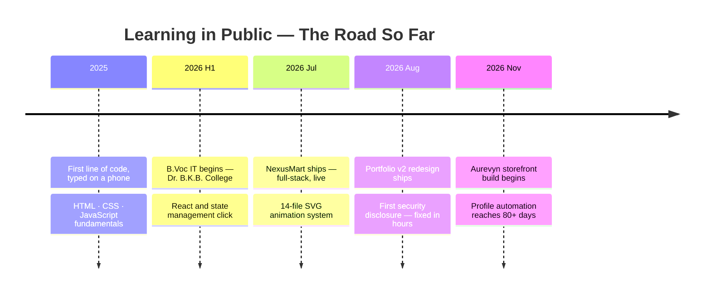

### 🌿 The journey as a git graph

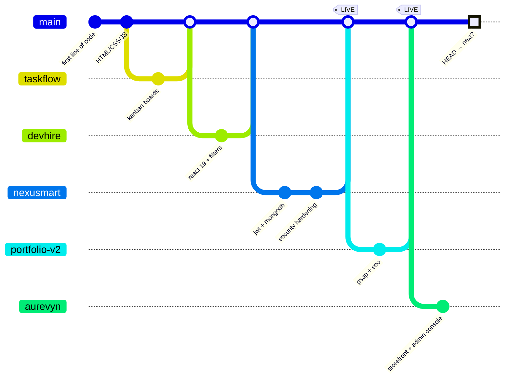


<div align="center">

# 🗂️ 02 · Selected Work — What Each One Taught Me

**Each repository is a stage of learning. Two are live in production:**

</div>

<div align="center">

## 🛍️ aurevyn-store — Systems Thinking <sub>`in progress · newest`</sub>

</div>

```text
┌─ OVERVIEW ──────────────────────────────┐
│ Meesho-resale storefront + admin console│
│ · Next.js + PostgreSQL                  │
│ · catalog, orders, reseller workflow    │
│ · autonomous operations layer           │
├─ WHAT IT IS TEACHING ME ────────────────┤
│ schema design · server actions          │
│ operational tooling · real users        │
│ shipping while still learning           │
└─────────────────────────────────────────┘
```

<div align="center">

[](https://github.com/Manashjyoti-Bora/aurevyn-store)

</div>

<div align="center">

## ⚡ portfolio — Frontend Engineering

</div>

```text
┌─ OVERVIEW ──────────────────────────────┐
│ Personal portfolio — 100% real data     │
│ · GSAP animations + AOS reveals         │
│ · custom cursor · offcanvas menu        │
│ · validated contact form · ATS resume   │
│ · full SEO · sitemap · mobile-first     │
├─ SKILLS APPLIED ────────────────────────┤
│ HTML5 · CSS3 · JavaScript ES6+ · Vite   │
│ GSAP · AOS · responsive design          │
│ SEO · clean code · Vercel deploy        │
└─────────────────────────────────────────┘
```

<div align="center">

[](https://portfolio-manashjyoti-bora.vercel.app)&nbsp;[](https://github.com/Manashjyoti-Bora/portfolio)

</div>

<div align="center">

## 🛒 nexusmart — Backend, Database & Security

</div>

```text
┌─ OVERVIEW ──────────────────────────────┐
│ Full-stack e-commerce: auth, cart,      │
│ checkout, orders                        │
│ · JWT (HTTP-only cookies) + bcrypt      │
│ · MongoDB Atlas, persistent orders      │
│ · Role-based admin dashboard            │
│ · Server-side price validation          │
├─ SKILLS APPLIED ────────────────────────┤
│ Mongoose models · Zod validation        │
│ REST API design · auth flows            │
│ env secrets · production debugging      │
└─────────────────────────────────────────┘
```

> [!WARNING]
> **Real lesson, learned in production:** a developer intercepted my
> checkout request and bought headphones for ₹1 — because I trusted
> client-side prices. Fixed within hours: the server now rebuilds every
> order from database prices only. *Never trust the frontend.*[^3]

<div align="center">

[](https://nexusmart-dusky.vercel.app)&nbsp;[](https://github.com/Manashjyoti-Bora/nexusmart)

</div>

<div align="center">

## 🧪 devhire-pro-ats & taskflow-enterprise

</div>

```text
┌─ UI PATTERNS & STATE ───────────────────┐
│ DevHire  · React 19 job portal + ATS    │
│          · real-time filtering          │
│ TaskFlow · Kanban boards · priorities   │
│          · optimistic UI updates        │
└─────────────────────────────────────────┘
```

<div align="center">

[](https://github.com/Manashjyoti-Bora/devhire-pro-ats)&nbsp;[](https://github.com/Manashjyoti-Bora/taskflow-enterprise)

</div>

### 🥧 Real code on my GitHub — measured, not guessed

<!--LANG-PIE:START-->
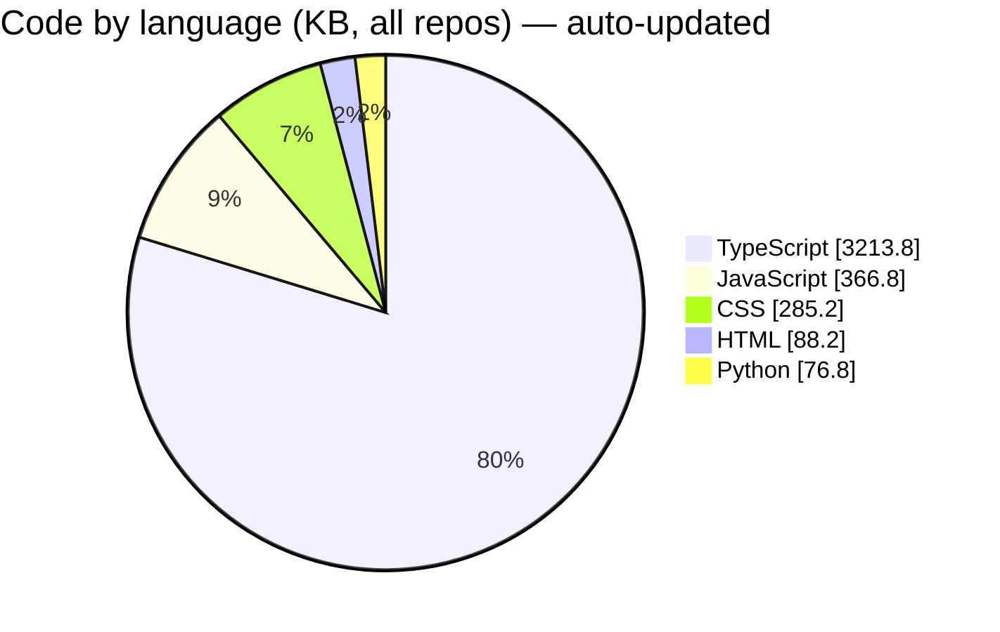
<sub>🤖 Regenerated from the live language API, 25 Nov 2026.</sub>
<!--LANG-PIE:END-->

### 📈 Where my repo energy went — honest self-assessment

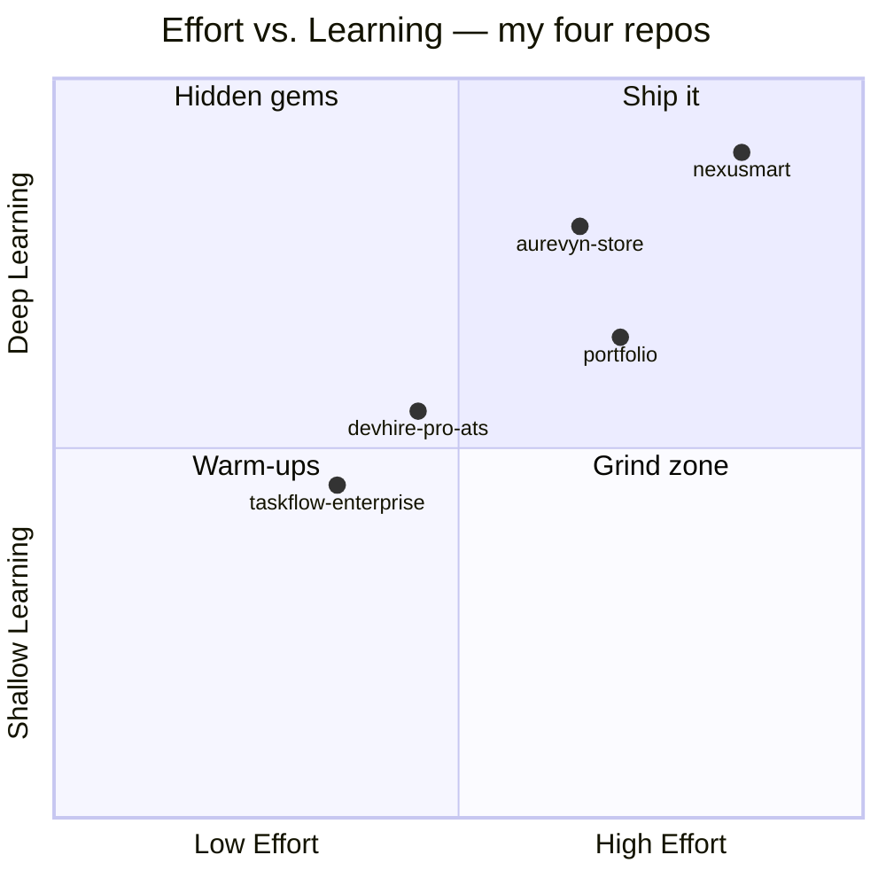


<div align="center">

# 🛠️ 03 · Skills & Environment

</div>


### 🧠 Skill map

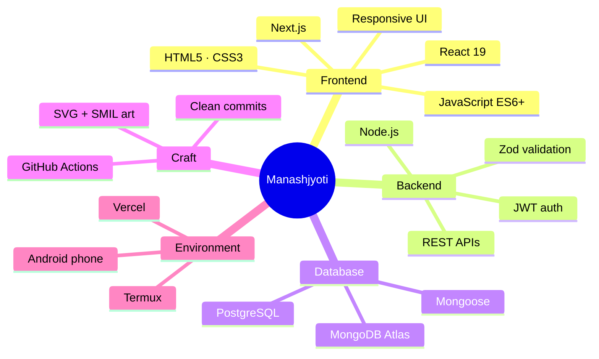

### Core stack

<div align="center">


<br>


</div>

### The whole office fits in a pocket

| Tool | Role |
|------|------|
| <kbd>📱 Android phone</kbd> | The entire machine |
| <kbd>Termux</kbd> | Git · Node.js · Python |
| <kbd>GitHub web editor</kbd> | Code editing |
| <kbd>Vercel</kbd> | Cloud builds & deploys |
| <kbd>MongoDB Atlas</kbd> | Database |



<div align="center">

# ⚙️ 04 · The Machine — Automation That Proves Itself

**Seven GitHub Actions pipelines keep this profile alive. None of them need a human.**

</div>

| Pipeline | Schedule | What it writes |
|----------|----------|----------------|
| **Daily self-update** | 02:30 UTC daily | Snapshot box, repo table, language pie, `assets/data/*.json` |
| **Live telemetry** | every 6 h | `assets/live-dark.svg` / `live-light.svg` |
| **Blueprint sheets** | every 6 h | as-built log, test report, sheet SVGs |
| **Signature margin** | every 12 h + on issues | visitor signatures in the sheet |
| **Snake** | 00:05 UTC daily | contribution snake (`output` branch) |
| **Pac-Man** | 00:10 UTC daily | Pac-Man contribution graph (`output` branch) |
| **3D city** | 03:00 UTC daily | `profile-3d-contrib/*.svg` |

<details>
<summary>🔧 <b>Why the bots never break each other</b></summary>

<br>

Every push goes through [`.github/scripts/push-safe.sh`](./.github/scripts/push-safe.sh):
commit → `git pull --rebase --autostash` → push, with up to 5 retries and a
15-second backoff. Concurrency groups serialize workflows in the same family, so
a push can never fail as "non-fast-forward". If the GitHub API is unreachable,
the README updater falls back to the last cached snapshot instead of dying.

The rules I keep: the markers belong to the bots, the prose belongs to me.
**Never hand-edit between the markers** — they are rebuilt from live API data.

</details>

<br>

<!--AUTO-UPDATE:START-->
```text
┌─ DAILY SNAPSHOT · LIVE DATA ──────────────────┐
│ 25 Nov 2026 · 17:08 IST                       │
│ 25 Nov 2026 · 11:38 UTC                       │
│ Public repos ..... 6                          │
│ Followers ........ 10                         │
│ Total stars ...... 3                          │
│ Commits (all) ... 1208                        │
│ Top language ..... TypeScript                 │
│ Last push ........ 2026-11-25                 │
│ Auto-update ...... 83d                        │
├───────────────────────────────────────────────┤
│ Generated by GitHub Actions — no hands        │
│ were involved.                                │
└───────────────────────────────────────────────┘
```
<!--AUTO-UPDATE:END-->

<br><br>

**📡 Live telemetry — this terminal is rebuilt every 6 hours by Actions:**


<br>

<!--REPO-INDEX:START-->
**6 public repos · 10 followers — table rebuilt from the live GitHub API.**

| Repository | Language | Stars | Last push |
|------------|----------|-------|-----------|
| [Manashjyoti-Bora](https://github.com/Manashjyoti-Bora/Manashjyoti-Bora) | Python | 0 ⭐ | 2026-11-25 |
| [aurevyn-store](https://github.com/Manashjyoti-Bora/aurevyn-store) | TypeScript | 0 ⭐ | 2026-11-24 |
| [portfolio](https://github.com/Manashjyoti-Bora/portfolio) | JavaScript | 0 ⭐ | 2026-08-15 |
| [taskflow-enterprise](https://github.com/Manashjyoti-Bora/taskflow-enterprise) | JavaScript | 1 ⭐ | 2026-07-28 |
| [devhire-pro-ats](https://github.com/Manashjyoti-Bora/devhire-pro-ats) | JavaScript | 1 ⭐ | 2026-07-28 |
| [nexusmart](https://github.com/Manashjyoti-Bora/nexusmart) | TypeScript | 1 ⭐ | 2026-07-28 |

<sub>🤖 Auto-updated 25 Nov 2026 11:38 UTC — [workflow](https://github.com/Manashjyoti-Bora/Manashjyoti-Bora/blob/main/.github/workflows/daily-update.yml)</sub>
<!--REPO-INDEX:END-->

<br><br>


**🐍 The snake — regenerated daily at 00:00 UTC:**


**👾 Pac-Man, eating the same graph:**


**🏙️ Contributions as a 3D city:**

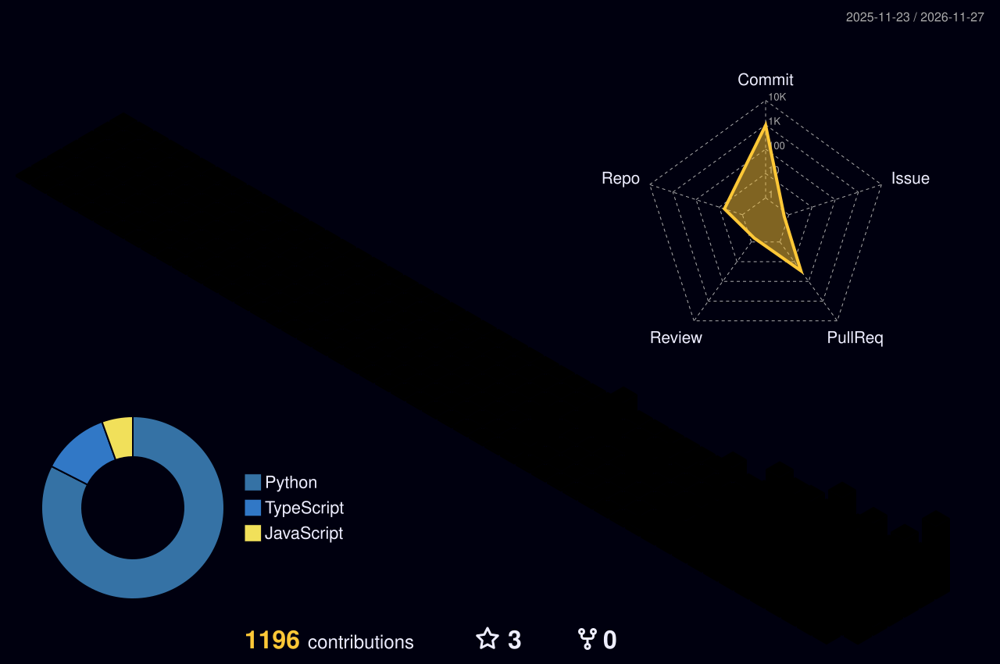


<div align="center">

# 💎 05 · The Rare Lab

**Things GitHub can render that almost nobody uses.**

</div>

### 🗺️ Where I build from — a real interactive map

Not a screenshot — GitHub renders GeoJSON as a **zoomable map**. That
marker is Nagaon, Assam, India. 🇮🇳

```geojson
{
  "type": "FeatureCollection",
  "features": [
    {
      "type": "Feature",
      "properties": { "name": "Nagaon, Assam — where the work happens" },
      "geometry": { "type": "Point", "coordinates": [92.68, 26.35] }
    }
  ]
}
```

### 🧊 A 3D model, rendered live in Markdown

GitHub renders STL as an **interactive 3D viewer** — drag to rotate.
One octahedron, hand-typed. My logo in 3D.

```stl
solid gem
facet normal 0 0 0
 outer loop
  vertex 0 0 14
  vertex 10 0 0
  vertex 0 10 0
 endloop
endfacet
facet normal 0 0 0
 outer loop
  vertex 0 0 14
  vertex 0 10 0
  vertex -10 0 0
 endloop
endfacet
facet normal 0 0 0
 outer loop
  vertex 0 0 14
  vertex -10 0 0
  vertex 0 -10 0
 endloop
endfacet
facet normal 0 0 0
 outer loop
  vertex 0 0 14
  vertex 0 -10 0
  vertex 10 0 0
 endloop
endfacet
facet normal 0 0 0
 outer loop
  vertex 0 0 -14
  vertex 0 10 0
  vertex 10 0 0
 endloop
endfacet
facet normal 0 0 0
 outer loop
  vertex 0 0 -14
  vertex -10 0 0
  vertex 0 10 0
 endloop
endfacet
facet normal 0 0 0
 outer loop
  vertex 0 0 -14
  vertex 0 -10 0
  vertex -10 0 0
 endloop
endfacet
facet normal 0 0 0
 outer loop
  vertex 0 0 -14
  vertex 10 0 0
  vertex 0 -10 0
 endloop
endfacet
endsolid gem
```

### 🧮 The consistency equation

$$\text{Skill}(t)=\int_{0}^{t}\text{commits}(\tau)\,d\tau \quad\Longrightarrow\quad \lim_{t\to\infty}\text{Skill}(t)={\color{#34E5A1}\text{mastery}}$$

<sub>Translation: show up every day, let the integral do its work.</sub>

### 🎢 The emotional journey (every developer knows this curve)

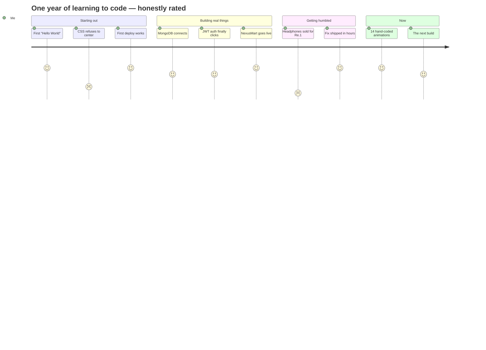


<div align="center">

# 🧭 06 · Roadmap

</div>

> [!CAUTION]
> I haven't locked a career path — deliberately. No fake titles here.
> The plan below is real, small, and checked off in public.

- [x] Ship a full-stack app with real auth (NexusMart)
- [x] Hand-code an SVG/SMIL animation system (14 files)
- [x] Rebuild portfolio with 100% real data
- [x] Survive a real security disclosure — and fix it fast
- [x] Build automation that maintains the profile itself (7 pipelines)
- [ ] Take Aurevyn from build to launch
- [ ] First open-source pull request
- [ ] Publish a tiny npm package
- [ ] Next.js App Router — deeper patterns
- [ ] **THE NEXT BUILD** — the work will decide 🧭


<div align="center">

# 📬 07 · Contact

</div>


<div align="center">

[](https://github.com/Manashjyoti-Bora)&nbsp;
[](https://www.linkedin.com/in/manashjyoti-bora-323b97405)&nbsp;
[](https://portfolio-manashjyoti-bora.vercel.app)&nbsp;
[](mailto:manashjyotibora122@gmail.com?subject=Hello%20Manashjyoti)&nbsp;
[](https://raw.githubusercontent.com/Manashjyoti-Bora/portfolio/main/assets/resume/Manashjyoti_Bora_Resume.pdf)

</div>

<div align="center">

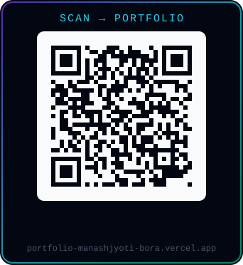

<sub>📱 Real scannable QR — point your camera at it. Meta: you're probably already on a phone, like this whole profile.</sub>

</div>

<details>
<summary>🔍 <b>How this page was built (tap to open)</b></summary>

<br>

| Layer | Detail |
|-------|--------|
| Hero, operator, stack, badge, connect | 5 theme-aware SVG sections, generated by [`build_next.py`](./build_next.py) |
| Motion | CSS keyframes only — no JS, no SMIL, honours `prefers-reduced-motion` |
| Portrait | Inlined base64 JPEG — the badge makes zero network requests |
| Dividers & cards | 14 hand-typed SVG files, zero JS |
| Map | Native GitHub GeoJSON rendering |
| QR code | Generated + styled by hand — scannable |
| 3D gem | Native GitHub STL viewer |
| Math | Native GitHub LaTeX (with colors!) |
| Diagrams | Mermaid timeline · gitGraph · journey · mindmap · quadrant · pie (real API data) |
| Pipelines | 7 GitHub Actions — all self-running, all conflict-safe |
| Hardware | One Android phone 📱 |

<details>
<summary>🥚 <b>One level deeper? (a nested easter egg)</b></summary>

<br>

You found it. 🎉 Fun facts nobody scrolls far enough to read:

- The hero monogram is **not an image** — it's a rounded rect with a gradient hairline and two text nodes. It weighs less than this sentence's font file.
- The rings you see rotating are `stroke-dashoffset` animations. No paths are being moved, which is why they stay smooth on a phone.
- The lanyard's light sweep is a 90 px gradient band clipped to the card. It loops every 7 seconds and runs entirely in CSS.
- My name in Assamese is <ruby>মনজ্যোতি<rt>Monojyoti</rt></ruby> — the <code>&lt;ruby&gt;</code> tag you just saw render is also rare on GitHub. 😄

<sub>If you read this far — say hi. I reply within 24h.</sub>

</details>
</details>


<div align="center">

<samp>manashjyoti@android:~$ echo "the work will decide" 🌱</samp>

<br><br>

<sub><kbd>↑</kbd> <kbd>↑</kbd> <kbd>↓</kbd> <kbd>↓</kbd> <kbd>←</kbd> <kbd>→</kbd> <kbd>←</kbd> <kbd>→</kbd> <kbd>B</kbd> <kbd>A</kbd> — you know the code. There's an easter egg above. 🥚</sub>

</div>

[^1]: Termux (Git, Node.js, Python) + GitHub web editor + Vercel cloud builds. No laptop was used for anything on this profile.
[^2]: The full story lives on my [portfolio](https://portfolio-manashjyoti-bora.vercel.app) — rebuilt in Aug 2026 with 100% real data.
[^3]: Responsible disclosure by a developer on LinkedIn. The fix commit is public in the [nexusmart repo](https://github.com/Manashjyoti-Bora/nexusmart).
