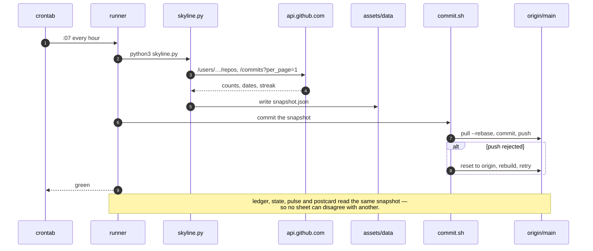
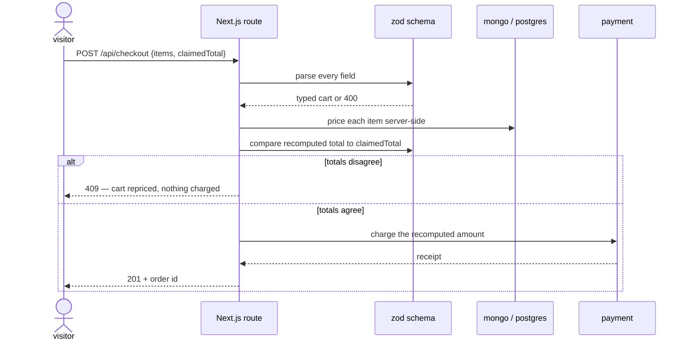
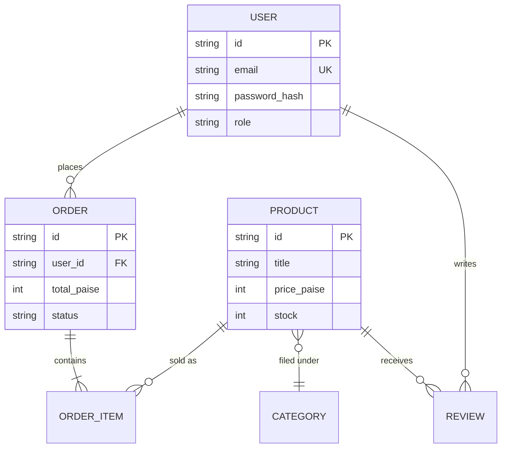
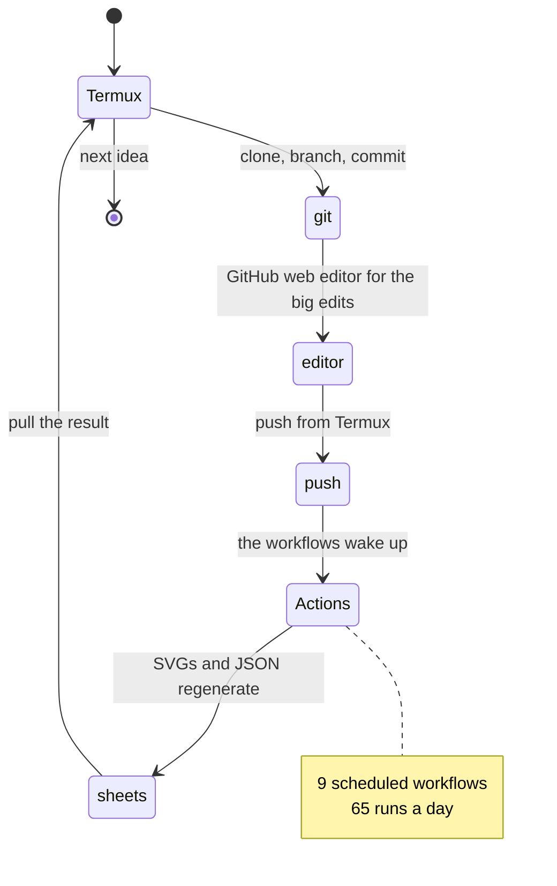

<!-- ═══════════════════════════════════════════════════════════════════════════ -->
<!--  MANASHJYOTI BORA · PROFILE · 2027 EDITION                                 -->
<!--  Two themes, one source: every picture is generated by art/*.py.           -->
<!--  Twelve workflows keep the numbers honest and redraw the sheets.            -->
<!--  Owned regions — a bot writes between them, so do not hand-edit inside:    -->
<!--    STATE · VITALS · POSTCARD · ASBUILT · WEEKLY · DAYBREAK                  -->
<!-- ═══════════════════════════════════════════════════════════════════════════ -->

<div align="center">

<picture>
  <source media="(prefers-color-scheme: dark)" srcset="./assets/art-header-aurora.svg?v=2027a">
  <source media="(prefers-color-scheme: light)" srcset="./assets/art-header-daylight.svg?v=2027a">
  
</picture>

<sub><ruby>মনজ্যোতি বৰা<rt>Manashjyoti Bora</rt></ruby> · Nagaon, Assam 🇮🇳 · full-stack developer · SVG craftsman · automation tinkerer</sub>

<br>

&nbsp;
&nbsp;


<br>

[](https://portfolio-manashjyoti-bora.vercel.app)&nbsp;
[](https://nexusmart-dusky.vercel.app)&nbsp;
[](https://www.linkedin.com/in/manashjyoti-bora-323b97405)&nbsp;
[](mailto:manashjyotibora122@gmail.com)

<br>

<sub><a href="#daybreak">daybreak</a> · <a href="#machine">01 the machine</a> · <a href="#work">02 work</a> · <a href="#ledger">03 ledger</a> · <a href="#live">04 live</a> · <a href="#review">05 self-review</a> · <a href="#phone">06 the phone</a> · <a href="#craft">07 the craft</a> · <a href="#wall">08 postcards</a> · <a href="#faq">faq</a></sub>

</div>

<!--DAYBREAK:START-->
> :sunrise: **today** — the first line of the day, written by `.github/scripts/daybreak.py` at 08:07 IST.
<!--DAYBREAK:END-->

<!--STATE:START-->
| 1,223 commits | 75-day streak | 2/2 apps live | 58% hygiene | 0 postcards |
| :--: | :--: | :--: | :--: | :--: |
<!--STATE:END-->

<picture>
  <source media="(prefers-color-scheme: dark)" srcset="./assets/state-aurora.svg?v=2027a">
  <source media="(prefers-color-scheme: light)" srcset="./assets/state-daylight.svg?v=2027a">
  
</picture>


<div align="center">
<a name="machine"></a>

# ⚙️ 01 · The Machine

**Nothing on this page is typed twice.** Every number you have seen so far, and every picture below, is the output of a workflow that runs on a crontab. This is that crontab, drawn from the workflow files themselves:

</div>

<picture>
  <source media="(prefers-color-scheme: dark)" srcset="./assets/art-pulse-aurora.svg?v=2027a">
  <source media="(prefers-color-scheme: light)" srcset="./assets/art-pulse-daylight.svg?v=2027a">
  
</picture>

### What each bot does

| automation | schedule (UTC) | what it produces | fails how |
| --- | --- | --- | --- |
| **skyline** | hourly, `:07` | `assets/data/snapshot.json`: commits, repos, streak, followers — the single source every other sheet reads | falls back to the last cache and writes nothing |
| **pulse** | `:23` every 4h | the clock above, by re-reading the cron lines of all 12 workflows | drawing only, so it cannot fail on the network |
| **ledger** | `:31` at 01/07/13/19 | the commit fan and the facts sheet | pure local Python |
| **live** | `:11` every 2h | two HTTPS probes per app, latency bar, content fingerprint | catches its own errors and draws them red |
| **findings** | `:47` every 3h | six hygiene checks across every repository | opens an issue if it finds a committed `.env`, never edits other repos |
| **postcard** | `:17` every 6h | the postcard wall, from real GitHub issues | marker-guarded; skips itself if the README has no slot |
| **state** | `:53` at 05/17 | the five headline numbers | reads local files only |
| **daybreak** | `:37` at 02 | one line a day: what actually happened | publishes "no commits" when there were none |
| **healthcheck** | `:29` at 04 | runs every generator against mock data and fails the build if any of them breaks | this is the one that protects the rest |

### Why the old version kept losing commits

The previous edition had each bot commit and push on its own. Several schedules fired in the same minute, so one push would win and the other would die with `Updates were rejected`. Two fixes went in:

```diff
-  git commit -m "chore: refresh" && git push        # loses the race, silently
+  bash .github/scripts/commit.sh "chore: refresh"   # rebase, retry, never give up
```

1. **one serialiser** — every bot writes through [`commit.sh`](./.github/scripts/commit.sh): stage, rebase on `origin`, commit, push, and on rejection reset and rebuild the commit on top of the winner instead of dying. Backoff, five tries.
2. **one writer per file** — each sheet owns its own `assets/data/*.json` and its own SVG names, so no workflow ever rewrites another's output and the rebase is always trivial.

There is a third property worth naming: **the pipeline verifies itself**. [`doctor.py`](./.github/scripts/doctor.py) checks that every asset the README references exists, that every marker pair appears exactly once, that every SVG parses and carries no script or external URL, that the cron counts on disk match the counts printed in the README, and that no relative link is dead. `healthcheck.yml` runs it nightly with `--strict`.


<details>
<summary><b>The vitals table — how each number is measured, in one place</b></summary>

<br>

<!--VITALS:START-->
| metric | value | how it is measured |
| --- | --- | --- |
| commits, all repos | 1,223 | the GitHub commits API, walked once per repo |
| hand-written | 1,203 (98%) | commits whose author is not `github-actions[bot]` |
| public repositories | 6 | `/users/…/repos?type=owner` |
| streak | 75 days | public contribution calendar |
| followers / stars | 10 / 3 | user + repo objects |
| live apps answering | 2 of 2 | two HTTPS probes per URL, 12 h |
| self-review | 58% | six checks × every repo, 12 h |
<!--VITALS:END-->

</details>

<details>
<summary><b>The full pipeline, as one sequence</b></summary>

<br>



</details>


<div align="center">
<a name="work"></a>

# 🧭 02 · Two Apps, In Production

</div>

### 🛍️ Aurevyn — a storefront with an operations team

A resale storefront (Meesho-style) built on Next.js + PostgreSQL, with an admin console and a small set of autonomous jobs that keep inventory and prices tidy. Still in progress — and the only project on this profile where the automation idea from *this* page is the product itself.

| layer | choice | why |
| --- | --- | --- |
| web | Next.js App Router, TypeScript | server components keep the storefront cheap on a phone-built codebase |
| data | PostgreSQL, schema-first | the admin console and the storefront must read the same truth |
| auth | session cookies, hashed passwords | no token in `localStorage`, ever |
| jobs | scheduled scripts in-repo | same philosophy as this profile: small Python, no mystery |

### ⚡ NexusMart — the one that taught me security

A full-stack store: JWT auth with bcrypt and HTTP-only cookies, cart and checkout, a role-gated admin panel, and Zod validation on every mutation.

The lesson worth repeating: **a ₹1 test order is cheaper than an audit**. When I probed my own checkout with a manipulated price, the server accepted it. The fix was not a UI check — it was moving the price computation server-side and validating the cart total against the database before payment. That is the difference between a demo and a product.



<details>
<summary><b>The data model, as an ER diagram</b></summary>

<br>



</details>


<div align="center">
<a name="ledger"></a>

# 🪶 03 · The Ledger

**Florence Nightingale drew a chart in 1858 because numbers in a table were not being read.** Same problem here: a commit count is a number, but *where the work lives* is a shape. Each feathered band below is one repository; its length is its share of all commits, and the hatched part is what the bots wrote.

</div>

<picture>
  <source media="(prefers-color-scheme: dark)" srcset="./assets/ledger-aurora.svg?v=2027a">
  <source media="(prefers-color-scheme: light)" srcset="./assets/ledger-daylight.svg?v=2027a">
  
</picture>

> A profile where the bots out-commit the human is a profile that will look alive forever without a single new idea. That is why the split is printed: it keeps the automation honest, and it keeps me honest about how much of this page is me.

The per-week rhythm, computed from the actual `git log` of this repository, lives in the build log below:

<!--WEEKLY:START-->
_commits per week, from the repository's own history_
<!--WEEKLY:END-->


<div align="center">
<a name="live"></a>

# 🛰️ 04 · Live, Right Now

Two HTTPS requests per app, every two hours, with the better latency kept. A fingerprint of the first 8 KiB tells us whether the page itself changed, not just whether it answered.

</div>

<picture>
  <source media="(prefers-color-scheme: dark)" srcset="./assets/live-aurora.svg?v=2027a">
  <source media="(prefers-color-scheme: light)" srcset="./assets/live-daylight.svg?v=2027a">
  
</picture>

<details>
<summary><b>What the fingerprint actually buys</b></summary>

<br>

A status code tells you a server answered. It does not tell you the server answered *the right thing* — an outage page is a 200. Hashing the response body means a deploy is visible here even when nothing is red:

| change | what you see | what it means |
| --- | --- | --- |
| `200 → 200`, new fingerprint | shape changes, `repeat` resets to 1 | a deploy landed |
| `200 → 200`, same fingerprint | `repeat` climbs | the page is stable for N runs |
| `200 → 5xx` | status turns red | real downtime; the workflow stays green |
| timeout twice | `0 ms` and red | the probe records the miss instead of hiding it |

</details>


<div align="center">
<a name="review"></a>

# 🔍 05 · The Bot Reviews Its Own Work

`findings.py` walks the root of every repository I own and checks six things that actually break projects: a README, a `.gitignore`, a licence, CI, tests, and a dependency manifest — plus one thing that should never happen: a committed `.env`.

The score below is **allowed to go down**. If a check fails, it is printed, not hidden. A percentage that can only rise is decoration.

| check | what counts | why it matters |
| --- | --- | --- |
| readme | any `README*` at the root | a repo nobody can understand is a repo nobody uses |
| gitignore | `.gitignore` present | `node_modules`, `.env`, editor droppings |
| licence | `LICENSE` / `LICENCE` / `COPYING` | without it, "public" is not the same as "usable" |
| ci | `.github/workflows` or a pipeline file | if it is never run, nobody knows when it is broken |
| tests | `tests/`, `__tests__/`, `*.test.*`, `test_*.py` | a learning project may skip these; a product may not |
| manifest | `package.json`, `pyproject.toml`, `requirements*.txt` | pinned dependencies are reproducible dependencies |

> The honest note: several of my early learning repositories were pushed before I understood why these things exist. The point of scoring them is not the number — it is that the next repository starts at six out of six by default.


<div align="center">
<a name="phone"></a>

# 📱 06 · The Phone

I do not own a laptop. Everything here — the art, the Python, the workflows, this sentence — is written on an Android phone, in [Termux](https://termux.dev) and GitHub's web editor.

```diff
- excuse:  "I'll start when I get a laptop."
+ reality: 2 apps in production, 9 automations, 14 SVGs, one phone.
```



The constraint shaped the whole design of this page. No local build server, so the art is generated where it can run: in GitHub Actions, on Python's standard library, with no dependencies to install.


<div align="center">
<a name="craft"></a>

# 🎨 07 · The Craft — How These Pictures Exist

Every SVG on this page is drawn by a Python module in [`art/`](./art). No design tools, no icon packs, no bitmaps except nothing at all. The whole set is deterministic: same inputs, same bytes, which is why `healthcheck.yml` can fail the moment a drawing drifts.

| module | draws | why it exists |
| --- | --- | --- |
| [`kit.py`](./art/kit.py) | the two palettes, escaping, arcs, a deterministic star field | one place for every colour, so the two themes cannot drift |
| [`header.py`](./art/header.py) | the identity plate and the commit skyline | a header that reports instead of decorating |
| [`pulse.py`](./art/pulse.py) | the heartbeat wheel | it *parses* the cron lines rather than repeating them |
| [`divider.py`](./art/divider.py) | the chapter rule | nineteen of them, 1.3 KB each |
| [`ledger.py`](./.github/scripts/ledger.py) | the feathered commit fan | a count turned into a shape people actually read |

Rebuild all of it with one command — data, sheets, README regions, then the checks:

```bash
python3 art/universe.py                 # everything, in the order the workflows use
python3 art/build_all.py --only pulse   # or one sheet, both themes
python3 art/preview.py                  # rasterise to artifacts/ for eyeballing
```

<details>
<summary><b>Why two themes, and how it is wired</b></summary>

<br>

GitHub re-renders Markdown images with the visitor's colour scheme, so every sheet is drawn twice and selected by a `<picture>` element:

```html
<picture>
  <source media="(prefers-color-scheme: dark)"  srcset="./assets/art-pulse-aurora.svg?v=2027a">
  <source media="(prefers-color-scheme: light)" srcset="./assets/art-pulse-daylight.svg?v=2027a">
  
</picture>
```

The `?v=2027a` query is the cache key. When a sheet changes, the version moves and every browser fetches the new file instead of a stale copy from the image CDN.

</details>


<div align="center">
<a name="wall"></a>

# ✉️ 08 · The Postcard Wall

Sign the drawing. Open an issue titled `[sign] your name`, write one line, and the wall redraws itself within six hours — one card per GitHub account, first one wins.

</div>

<picture>
  <source media="(prefers-color-scheme: dark)" srcset="./assets/postcard-aurora.svg?v=2027a">
  <source media="(prefers-color-scheme: light)" srcset="./assets/postcard-daylight.svg?v=2027a">
  
</picture>

**[✍️ Add your postcard →](https://github.com/Manashjyoti-Bora/Manashjyoti-Bora/issues/new?template=sign.yml)**

<!--POSTCARD:START-->
_the wall line, refreshed by the postcard workflow_
<!--POSTCARD:END-->


<div align="center">
<a name="faq"></a>

# 💬 FAQ

</div>

<details>
<summary><b>Is any of this fake?</b></summary>

<br>

No. Every number is read from the GitHub API or from local files that a workflow wrote. If a probe fails, it is drawn red; if a repository has no tests, the hygiene score drops. The one number this page deliberately does **not** show is "commits per second" — a 1 commit per second average is under 2% of the profile's lifetime total, so it would be a diagnostic flourish dressed up as a metric, not a fact about the work.

</details>

<details>
<summary><b>Why so much automation for a profile page?</b></summary>

<br>

Because the automation is the portfolio. This repository is a small, tested, self-verifying system with a twelve-workflow schedule, a commit serialiser, a hygiene scanner and a doctor — and it is durable proof that the same ideas work in a product. It is also the only place where I can show cron, Python, SVG and CI in one file tree.

</details>

<details>
<summary><b>Two themes — why?</b></summary>

<br>

Because a dark sheet on a light page is a bad page. Each picture is drawn twice from one palette definition and served through `<picture>`, so it follows the visitor's system theme. Nobody has to flip a switch.

</details>

<details>
<summary><b>What is this "feather fan" thing?</b></summary>

<br>

A homage to Florence Nightingale's 1858 army charts: when the data is counts in categories, draw the categories as bands whose thickness is the count. Here the bands are horizontal and give each repository its own wedge, with the automated share hatched — because the split between human and bot commits is the thing worth seeing at a glance.

</details>

<details>
<summary><b>Can I steal the setup?</b></summary>

<br>

Yes. Copy `art/kit.py` and `art/build_all.py`, keep the palettes, drop what you don't need. The workflows are deliberately boring — `actions/checkout`, `setup-python`, one script, one commit script — so they can be lifted into any repository. See `.github/scripts/doctor.py` and copy the checks that catch your own mistakes first.

</details>


<div align="center">

# 📮 Say Hello

[](https://portfolio-manashjyoti-bora.vercel.app)&nbsp;
[](https://www.linkedin.com/in/manashjyoti-bora-323b97405)&nbsp;
[](mailto:manashjyotibora122@gmail.com)

$${\color{#4DE1FF}\textsf{learning in public}} \cdot {\color{#9B8CFF}\textsf{building from a phone}} \cdot {\color{#5BF2B8}\textsf{the work decides}}$$

<sub>This page rebuilds itself. The source is the repository you are looking at.</sub>

</div>

## 🧱 Build log

Last commits of this repository, straight from `git log`:

<!--ASBUILT:START-->
```diff
+ 2026-11-25  (the build log regenerates on every sheet run)
```
<!--ASBUILT:END-->

<sub>Everything above is generated by `art/*.py` and `.github/scripts/*.py` · 12 workflows · see [`doctor.py`](./.github/scripts/doctor.py) for the checks that keep it honest.</sub>
